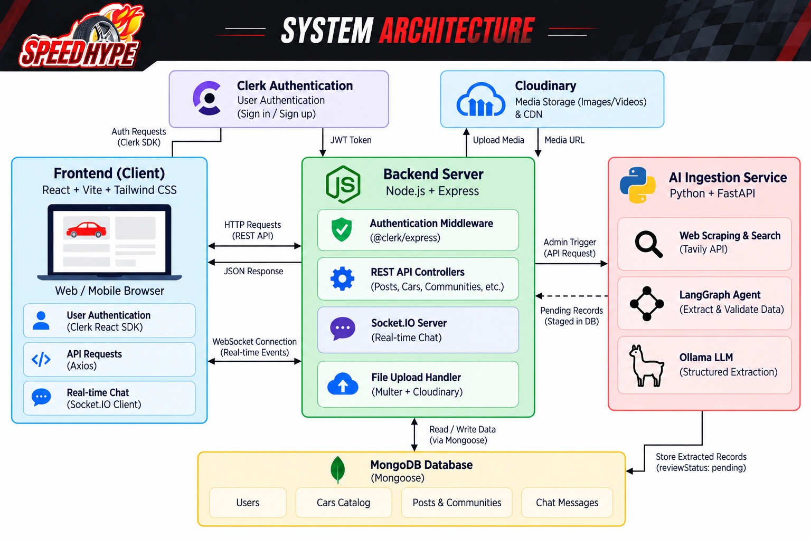

#  SpeedHype - All-in-one Automotive Community Platform

[](https://react.dev/)
[](https://expressjs.com/)
[](https://www.mongodb.com/)
[](https://clerk.com/)
[](https://tailwindcss.com/)
[](https://langchain-ai.github.io/langgraph/)

SpeedHype is a  automotive community and vehicle information web application built for petrolheads, automotive enthusiasts, and everyday car buyers. Combining the excitement of community social feeds, real-time chats, and verified Indian vehicle catalogs with an  side-by-side vehicle comparison.

---

##  Architecture Diagram



##  Key Features

### 1. Curated Automotive Catalog & Spec Sheets
- **India-Market Vehicle Database**: Browse and filter curated cars by brand, body style, fuel type, transmission, seating capacity, and price brackets in Indian Rupees (INR).
- **Comprehensive Technical Specs**: Detailed specs covering engine displacement, horsepower, peak torque, fuel economy, transmission options, dimensions, ground clearance, and safety ratings.
- **Evidence & Source Attribution**: Transparent tracking of specification sources with supporting quotes and official links.

### 2. Vehicle Comparison
- **Interactive Dual Selector**: Compare any two vehicles side-by-side across dimensions, powertrains, performance metrics, and pricing.
- **Highlight Differences**: Quick toggle to spotlight diverging metrics and contrast key advantages.
- **Responsive Comparison Matrix**: Built with clean tabular layouts adapted for both compact mobile viewports and wide displays.

### 3. Real-Time Community Chat
- **Interest-Driven Clubs**: Create and join automotive clubs tailored to brands, motorsports, tuning, and regional meetups.
- **Socket.IO Live Chat**: Low-latency authenticated chat rooms with member lists and real-time status indicators.
- **Rich Media Sharing**: Support for image and video attachments up to 12 MB powered by Cloudinary and binary media handling.


---

## Technologies Used

### Frontend
- **React 19** (`19.2.8`) - Modern UI component architecture with hooks and concurrent features
- **Vite** (`8.3.0`) - Ultra-fast development server and optimized build tooling
- **Tailwind CSS v4** (`4.3.3`) - Utility-first styling with modern CSS engine
- **React Router DOM v7** (`7.18.4`) - Declarative client-side routing
- **@clerk/react** (`6.17.7`) - Complete frontend authentication, session management, and user controls
- **Socket.IO Client** (`4.8.4`) - Real-time bidirectional WebSocket client for community chat
- **Axios** (`1.20.0`) - Promise-based HTTP client with authenticated request interceptors
- **Lucide React** - High-quality iconography for automotive and dashboard interfaces

### Backend
- **Node.js** - High-performance asynchronous JavaScript runtime (v18+)
- **Express 5** (`5.2.1`) - Scalable REST API framework
- **MongoDB & Mongoose** (`9.11.1`) - Schema validation, indexing, and object modeling
- **@clerk/express** (`2.1.77`) - Secure session token verification and middleware
- **Socket.IO** (`4.8.4`) - Authenticated real-time WebSocket communication server
- **Cloudinary** (`2.11.0`) - Cloud-based media storage and asset transformation
- **Multer** (`2.4.0`) - Multipart form data handling for media uploads

### AI & Ingestion Service
- **Python 3.11+** & **FastAPI** (`0.115+`) - Microservice architecture for ingestion workflows
- **LangGraph** (`0.2+`) - Agentic state graphs orchestrating multi-step source fetching, extraction, and validation
- **Ollama** - Local LLM integration (no paid LLM API required) for zero-cost structured extraction
- **Tavily Search API** - Evidence gathering restricted to official manufacturer and automotive domains
- **BeautifulSoup4** - Source document parsing and robots policy compliance enforcement

---

## 📁 Repository Structure

```text
SpeedHype/
├── client/                     # Frontend Single Page Application (React 19 + Vite)
│   ├── public/                 # Static assets & browser favicon
│   ├── src/
│   │   ├── assets/             # Logos and automotive imagery
│   │   ├── components/         # Reusable UI components (Navbar, Modals, Feed, Compare)
│   │   ├── layouts/            # Main layout and view wrappers
│   │   ├── pages/              # Application views (Home, Feed, Cars, Admin, Compare, etc.)
│   │   ├── services/           # Axios API services and Clerk auth helpers
│   │   ├── App.jsx             # Route definitions & Clerk provider wrappers
│   │   └── index.css           # Global Tailwind CSS v4 styling rules
│   └── package.json
├── server/                     # Backend API & WebSocket Server (Node.js + Express 5)
│   ├── src/
│   │   ├── config/             # Database connection & Cloudinary setup
│   │   ├── controllers/        # Route controllers (cars, auth, communities, feed, etc.)
│   │   ├── middleware/         # Clerk auth guards and validation middlewares
│   │   ├── models/             # Mongoose schemas (CarCatalog, Community, User, Post, etc.)
│   │   ├── routes/             # REST API endpoint definitions
│   │   ├── sockets/            # Socket.IO room & message event handlers
│   │   └── server.js           # Server bootstrap and listener
│   └── package.json
├── ai-services/                # Background Ingestion & Verification Agent (Python)
│   ├── agent/                  # LangGraph workflow, Tavily search & Ollama extraction
│   ├── tests/                  # Ingestion unit tests and mock validations
│   └── requirements.txt
├── docs/                       # Project architecture documentation
└── README.md                   # Project documentation
```

---

## ⚙️ Setup & Installation Instructions

### Prerequisites
Before setting up the project, ensure you have the following installed on your machine:
- **Node.js** (v18.0.0 or higher) & **npm** (v9.0.0 or higher)
- **Python** (v3.11 or higher) *(required only for AI ingestion worker)*
- **MongoDB** (Local instance or free MongoDB Atlas URI)
- **Clerk Account** ([clerk.com](https://clerk.com)) - for authentication keys
- **Cloudinary Account** *(optional, for image/media uploads)*

---

### Step 1: Clone the Repository

```bash
git clone https://github.com/Chiragchaudhari2005/SpeedHype.git
cd SpeedHype
```

---

### Step 2: Configure Environment Variables

#### 1. Frontend Configuration (`client/.env.local` or `client/.env`)
Create a `.env.local` file inside the `client` directory:

```env
VITE_CLERK_PUBLISHABLE_KEY=pk_test_your_clerk_publishable_key
VITE_API_URL=http://localhost:5000/api
```

#### 2. Backend Configuration (`server/.env`)
Create a `.env` file inside the `server` directory:

```env
PORT=5000
MONGO_URI=mongodb+srv://<username>:<password>@cluster.mongodb.net/speedhype?retryWrites=true&w=majority
CLERK_PUBLISHABLE_KEY=pk_test_your_clerk_publishable_key
CLERK_SECRET_KEY=sk_test_your_clerk_secret_key
CLIENT_ORIGIN=http://localhost:5173

# Optional: Cloudinary configuration for image uploads
CLOUDINARY_CLOUD_NAME=your_cloudinary_cloud_name
CLOUDINARY_API_KEY=your_cloudinary_api_key
CLOUDINARY_API_SECRET=your_cloudinary_api_secret

# Admin Authorization (Comma-separated Clerk User IDs)
CAR_CATALOG_ADMIN_USER_IDS=user_xxxxxxxxxxxxxxxxx

# AI Ingestion Service Shared Secret
CAR_INGESTION_SHARED_SECRET=your_shared_secret_passphrase
CAR_INGESTION_AGENT_AUTOSTART=false
```

#### 3. AI Services Configuration (`ai-services/.env`) *(Optional)*
Create a `.env` file inside the `ai-services` directory:

```env
MONGO_URI=mongodb+srv://<username>:<password>@cluster.mongodb.net/speedhype?retryWrites=true&w=majority
TAVILY_API_KEY=tvly-your_tavily_key
CAR_INGESTION_SHARED_SECRET=your_shared_secret_passphrase
EXPRESS_API_URL=http://localhost:5000/api
OLLAMA_MODEL=mistral
SOURCE_POLICY_APPROVED=true
```

---

### Step 3: Install Dependencies

```bash
# Install Server Dependencies
cd server
npm install

# Install Client Dependencies
cd ../client
npm install

# Optional: Install Python AI Dependencies
cd ../ai-services
python -m venv .venv
# Windows:
.\.venv\Scripts\pip install -r requirements.txt
# Linux/macOS:
source .venv/bin/activate && pip install -r requirements.txt
```

---

## How to Run the Application

You can run the frontend and backend in separate terminal tabs:

### Terminal 1: Run Backend Server
```bash
cd server
npm run dev
```
- **Server running at:** `http://localhost:5000`
- **Health check endpoint:** `http://localhost:5000/api/health`

### Terminal 2: Run Frontend Client
```bash
cd client
npm run dev
```
- **Client running at:** `http://localhost:5173`

### Terminal 3: Run AI Ingestion Worker *(Optional)*
```bash
cd ai-services
# Windows:
.\.venv\Scripts\python -m uvicorn agent.main:app --host 127.0.0.1 --port 8010
# Linux/macOS:
source .venv/bin/activate && python -m uvicorn agent.main:app --host 127.0.0.1 --port 8010
```

---

##  AI Development Experience

### AI Tool Selection
For the architecture, development, and refinement of SpeedHype, **Kiro** was used as the primary AI pair programmer and agentic development tool.

### Overview of AI Development Experience
Developing SpeedHype with **Kiro** significantly accelerated full-stack iteration speed while maintaining high code quality and architecture coherence:
- **Context-Aware Scaffolding**: Kiro seamlessly mapped relationships across the MERN stack, ensuring that changes to Mongoose database schemas were mirrored in Express controller validations, Clerk authorization policies, and React frontend components.
- **Automotive Design System Consistency**: Rather than generating disjointed or generic styles, Kiro adhered to an intentional dark automotive aesthetic using carbon backgrounds, subtle amber/red speed accents, and precise responsive layouts.
- **Strict Evidence-Grounded Logic**: During the creation of the car catalog and comparison tools, Kiro ensured that missing specifications remained clean `null` values rather than hallucinating artificial values, strictly respecting real-world technical accuracy.

---

##  Specific Tasks Accomplished Using the AI Tool (Kiro)

Here are **4 specific tasks** where Kiro was directly utilized during development:

### 1. Component Development: Interactive Vehicle Comparison Duel & Header Navigation
- **What was built**: Developed the side-by-side car comparison duel interface (`client/src/pages/CompareCars.jsx`) allowing users to choose two vehicles, inspect matched/diverging powertrain and chassis dimensions, and highlight differences.
- **Kiro's Contribution**: Implemented sticky column headers, null-safe specification tables, difference calculation logic, and a fully responsive automotive navigation bar with dynamic Clerk authentication states and animated mobile drawer menus.

### 2. API Creation & Server Validation: Manual Car Entry & Admin Catalog Controller
- **What was built**: Created the admin REST API endpoints for manual vehicle entries (`POST /api/cars/catalog/manual`) and car updates (`PUT /api/cars/catalog/:id`).
- **Kiro's Contribution**: Wrote Express 5 controllers with granular field validations (handling numeric conversions for horsepower, displacement, torque, mileage, and dimensions), integrated Cloudinary image upload workflows, and secured endpoints using Clerk admin allowlist middleware.


### 3.Debugging 
- **What was built**: Diagnostic and resolution phase across client-side API interceptors and build pipelines and CLerk Authentication.
- **Kiro's Contribution**: Pinpointed subtle synchronization race conditions in Clerk's `getToken()` template authorization flow, fixed unhandled asynchronous states in Socket.IO community joins, and refactored components to pass strict ESLint rules and Vite React compiler checks with zero errors.

### 4. UI/UX Refactoring & Comprehensive Responsive Overhaul
- **What was built**: Complete responsive overhaul of the entire application across mobile (320px+), tablet, and desktop viewports without horizontal scroll leaks.
- **Kiro's Contribution**: Systematically audited and polished all pages—including Feed, Communities, Blogs, Car Catalog, and Admin Review Dashboard—replacing generic UI patterns with tailored automotive cards, accessible typography, high-contrast badges, and smooth micro-interactions.

**SpeedHype** - Built for the Drive. Engineered for Enthusiasts. 
