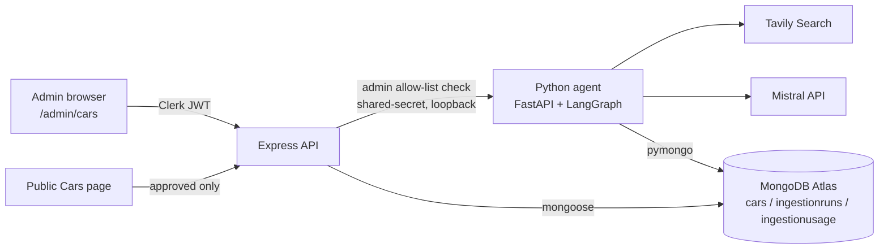

# Data Ingestion Architecture

## Goal
Seed the SpeedHype car catalog with **auditable** data using free API tiers. The pipeline is not a general scraper: retrieval goes through Tavily (a licensed search API) restricted to a curated domain list, an LLM only *reads* the text it is given, and deterministic code decides what is accepted. Nothing is public until an admin approves it.

## Components

| Layer | Responsibility |
|---|---|
| React `AdminCarsPage` | trigger, run status/logs/errors, review queue, approve/reject |
| Express `/api/car-catalog/*` | Clerk auth, **server-side admin check** (`CAR_CATALOG_ADMIN_USER_IDS`), input validation, review state transitions, read-only run data |
| Python `ingestion/` | search, extraction, validation, cross-checking, quota control, idempotent upserts |
| MongoDB | `cars` (existing Mongoose schema + review/audit fields), `ingestionruns`, `ingestionusage` |

## LangGraph flow (`ingestion/graph.py`)
1. **select_targets** – walk `targets.py`, skip cars already stored (any variant/status), take N. No LLM spent on discovery.
2. **search_sources** – one Tavily query per car, `include_domains` = official + secondary list. Results are re-checked in code: any URL outside the lists is dropped. If no official page appears, one extra query restricted to official domains. Pages must mention brand and model.
3. **extract_data** – one Mistral call per retained page (≤ `MAX_SOURCES_PER_CAR`), JSON mode, temperature 0, only spec-relevant passages sent. Every value must come with a verbatim quote; unknown = `null`.
4. **validate_and_persist** – deterministic validation (below) → upsert as `pending`.

Quota exhaustion sets a halt flag: remaining external calls are skipped, collected data is still validated/saved, and the run ends as `quota_exhausted`.

## Validation rules (`ingestion/validate.py`)
- **Evidence**: quote must exist in the text the model saw; the value must be inside the quote (prices parsed incl. lakh/crore). Fabricated quotes → value discarded.
- **Types/units/ranges**: power (bhp/ps/kW/hp), torque (Nm/kgm), mileage (kmpl, km/kg) or EV range (km), seats 2–9, price ₹1.5 lakh–₹15 crore. Unknown units or implausible values are discarded.
- **Model year**: a source stating a different year is excluded; an unconfirmed year is flagged.
- **Category**: only with an explicit, unambiguous quote (EVs may derive `electric` from a source-stated fuel type); otherwise null and an admin must choose.
- **Cross-check** (price, power, torque, mileage, engine, fuel, transmission, seats): units are normalised, then values from *different domains* compared. States: `cross_checked`, `single_source`, `conflict` (value stored as null, both values kept in `validation.conflicts`), `missing`.
- **Recommendation**: `ready_for_review` or `needs_attention` (any warn/error). This is a triage hint, **not** verification.

## Data model additions (`Car`)
`reviewStatus` (`pending|approved|rejected`), `reviewedBy/At`, `reviewNotes`, `approvalOverrideReason`, `validation`, `sources[]`, `ingestionRunId`, `ingestedBy`; per-field `fieldSources` (quote + URL + corroborating URLs); images carry `attribution`, `license`, `permissionStatus`. `sourceVerifiedAt` means “sources last checked”, not “facts guaranteed”.

Duplicate prevention: unique `identityKey = brand|model|variant|year` (same normaliser as the Express code). Upsert filter is `{identityKey, reviewStatus:'pending'}`; if the record already exists as approved/rejected the insert hits the unique index and is reported as `skipped_existing`.

## Review workflow
- `POST /car-catalog/review/:id/approve` – requires a valid category; if the record `needs_attention`, a written justification (≥10 chars) is mandatory. Images are cleared unless the admin confirms permission. Compare-and-set on `reviewStatus:'pending'` prevents double review.
- `POST /car-catalog/review/:id/reject` – reason required.
- Public `GET /car-catalog` and `/:id` filter `reviewStatus:'approved'`.

## Security
- Browser never sees secrets; `TAVILY_API_KEY`, `MISTRAL_API_KEY`, `MONGO_URI` exist only in `ai-services/.env`.
- Admin = Clerk-authenticated **and** in server-side allow-list. `requestedBy`/`reviewedBy` come from the verified session, never client input.
- Express→Python: bearer shared secret (constant-time compare), loopback bind, 1–25 cars per call.

## Free-tier controls
Per-run cap; daily/monthly counters in `ingestionusage` (Tavily ≈1 credit per basic search, Mistral per page); retries with exponential backoff and `Retry-After`; 30 s timeouts; HTTP 429/432/433/402 → clean quota stop. Default limits: 25 cars/run, 200 Mistral calls/day, 60 Tavily searches/day, 900/month.

## Known limitations
- Target list is curated (`targets.py`), model year defaults to 2025 and is flagged when no source confirms it.
- One record per model (base/stated variant); multi-variant ingestion is future work.
- Tavily `raw_content` can be partial; missing facts remain null rather than guessed.
- Secondary-domain terms are not machine-checked; we use short quotes for attribution only. Review image permissions before publishing.
